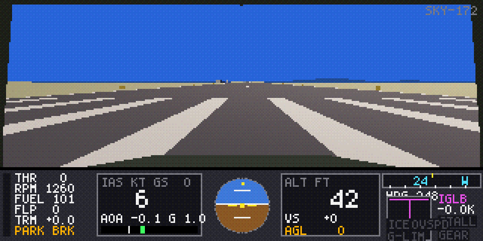

# STRATO-32

320×160 像素风、1:32 过程化星球、硬核 6-DOF 气动的复古飞行模拟器（Rust workspace + Bevy 0.18）。
详见 [Spec.md](Spec.md)。当前进度：**M1–M3 完成并有测试覆盖**。



## 运行

```bash
# Linux 需要: pkg-config libasound2-dev libudev-dev libwayland-dev libxkbcommon-dev libx11-dev ...
cargo run -p app_client --release -- [--seed N] [--icao XXXX] [--day D] [--hour H]
cargo run -p app_client --features dev      # 开发期动态链接加速
```

按键：W/S 俯仰、A/D 滚转、Q/E 方向舵、Shift/Ctrl 油门、Z/X 全油门/慢车、F/V 襟翼、G 起落架、
Space 刹车、B 驻车刹车、T/Y 配平、H 皮托加温、I 除冰、J 减速板、K 反推、1–4 视角、
M 航图、C 切换天气预设、P 暂停、Backspace 重置。

## 测试（全部无头，无需 GPU）

```bash
cargo test --workspace
```

| crate | 内容 |
| --- | --- |
| `sim_core` | 单元测试 + `tests/sky172_flight.rs`（M1：起飞 55–65 kt、失速、升限自然衰减、进近刹停；M3：结冰失速速度、超速/超 G 断翼）+ `tests/m3_weather_structure.rs`（风/风切变/乱流、能见度、湿滑跑道、结冰链路、皮托管加热、除冰、V_FE 卡襟翼、重着陆、折翼后果…） |
| `world_gen` | `tests/world_tests.rs`（确定性、海洋占比、跑道平坦、季节反转）+ `tests/m2_extra.rs`（±180° 跨界无撕裂、100 km f64 精度、机场/ILS/PAPI 几何、`airport_near`、气候单调性…） |
| `app_client` | `src/headless_tests.rs`：浮动原点精度、网格/地形 Chunk 无裂缝、驾驶舱像素渲染、航图、输入系统、`WorldGround`、**飞越 ±180°**、**雾/雨/雪中仅凭 ILS 盲降** |

## 里程碑状态

* M1 ✅ 物理核心 + 最小可飞原型
* M2 ✅ 1:32 星球、季节气候、机场网络、Floating Origin、LOD 地形、航图
* M3 ✅ 天气/结冰/结构损坏、ILS 仪表、三视角、程序化音效
* M4 ⏳ 其余 4 种机型
